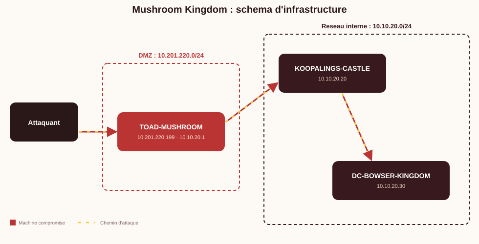
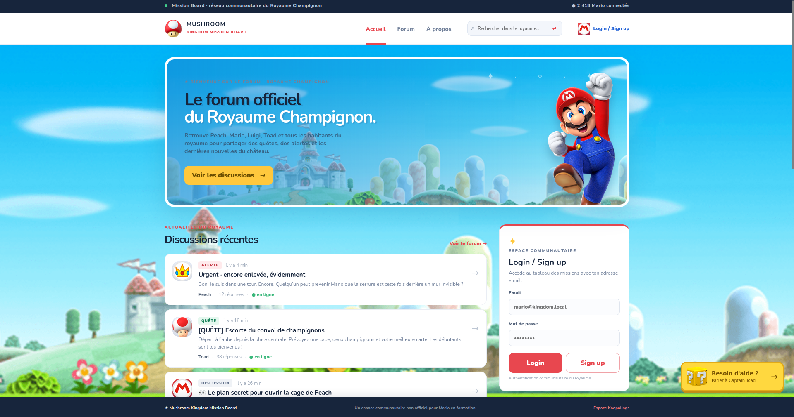

# Lab Mushroom Kingdom

A full infrastructure CTF lab set in the Mario universe.

The pentester takes on the role of Mario and is tasked with saving Princess Peach. The attack chain spans 3 machines: a Linux server hosting a community forum, a Windows IIS server guarding the castle, and Bowser's Active Directory domain controller.

## Infrastructure



## Writeup

> **Full writeup with screenshots available in English and French:**
>
> - [`docs/writeup/writeup-en.md`](docs/writeup/writeup-en.md) (English)
> - [`docs/writeup/writeup-fr.md`](docs/writeup/writeup-fr.md) (French)

## Attack chain

| Step | Vector | Result |
|---|---|---|
| Recon | PTR + subdomain bruteforce (DNS port 5353) | discovery of `forum.mushroomkingdom.local` |
| Credential leak | Captain Toad chatbot (keywords) | authenticated access to the forum |
| LFI | search parameter `q` (authenticated) | arbitrary file read |
| Linux RCE | LFI + `data://` wrapper (`allow_url_include = On`) | `www-data` shell on TOAD |
| Linux Privesc | weak KeePass vault -> vim escape -> `sudo vim` GTFOBins | root on TOAD |
| Pivot | credentials in `/root` | access to internal network |
| Windows RCE | unrestricted `.aspx` upload on IIS | shell on KOOPALINGS-CASTLE |
| Windows Privesc | `SeImpersonatePrivilege` + GodPotato | SYSTEM on KOOPALINGS-CASTLE |
| Cached credentials | WDigest enabled + scheduled task | Domain Admin password in cleartext (LSASS) |
| Final flag | RDP/PSExec | Domain Admin on DC-BOWSER-KINGDOM |

## Architecture

| Machine | OS | IP | Role |
|---|---|---|---|
| `TOAD-MUSHROOM` | Ubuntu 24.04 | `ens3` DHCP (DMZ) / `ens4` 10.10.20.1/24 | Foothold LFI -> RCE, pivot |
| `KOOPALINGS-CASTLE` | Windows Server 2022 | 10.10.20.20/24 | IIS + unrestricted upload, SeImpersonatePrivilege |
| `DC-BOWSER-KINGDOM` | Windows Server 2022 | 10.10.20.30/24 | DC `mushroomkingdom.local`, final flag |

No Windows machine has a default gateway: all pivoting must go through an application-level tool (e.g. Ligolo-ng), not IP routing (`ip_forward=0` on TOAD).

## Prerequisites

- `ansible` >= 2.16 with `pywinrm`: `pip install pywinrm`
- Ansible collections: `ansible-galaxy collection install community.windows microsoft.ad ansible.windows ansible.posix`
- SSH key access to TOAD-MUSHROOM
- The Ansible controller must **not** be TOAD (see WinRM security note below)

### Disk note - TOAD-MUSHROOM

The root disk is only 2.4G. TOAD has a second disk (~10G) mounted at `/mnt/data` by the Ansible role. The apt cache, Apache logs and webroot are bind-mounted to this disk. A `disk-guard` timer monitors usage every 10 min and journald is capped at 100M.

## Deployment

### 1. Configure secrets

```bash
cp ansible/group_vars/credentials.example.yml ansible/group_vars/credentials.yml
# Edit credentials.yml with your values
ansible-vault encrypt ansible/group_vars/credentials.yml
```

### 2. SSH tunnel for WinRM

Windows machines are only reachable through TOAD. Open a tunnel in a separate terminal:

```bash
ssh -N \
  -L 15985:10.10.20.20:5985 \
  -L 15986:10.10.20.30:5985 \
  -i <private_key> ubuntu@<TOAD_DMZ_IP>
```

### 3. Deploy roles

```bash
# TOAD (network, firewall, webapp, KeePass, toadette, castle_access.txt)
ansible-playbook -i ansible/inventory.yml ansible/site.yml --tags toad --ask-vault-pass

# DC-BOWSER (DA account, flag, hardening) — run BEFORE koopalings
ansible-playbook -i ansible/inventory.yml ansible/site.yml --tags bowser --ask-vault-pass

# KOOPALINGS (IIS, upload.aspx, WDigest, bowser_admin scheduled task)
ansible-playbook -i ansible/inventory.yml ansible/site.yml --tags koopalings --ask-vault-pass
```

### 4. Lockdown before exam

```bash
ansible-playbook -i ansible/inventory.yml ansible/site.yml --tags lockdown --ask-vault-pass
```

This stops and disables WinRM on KOOPALINGS-CASTLE to prevent direct access using the `castle_access.txt` credentials. Only port 80/tcp remains open.

## WinRM security note

The `castle_access.txt` file on TOAD contains `svc_bowser_jr` credentials in plaintext (intentional for the lab). If WinRM remained open on KOOPALINGS-CASTLE, an attacker with root on TOAD could bypass the IIS -> upload -> SeImpersonatePrivilege chain. The `lockdown` tag is therefore **mandatory** before each session.

To re-enable WinRM after a session (from TOAD):

```bash
wmiexec.py "MUSHROOMKINGDOM/Administrator:<password>@10.10.20.20" \
  "powershell -Command Set-Service WinRM -StartupType Automatic; Start-Service WinRM"
```

## Structure

```
lab-mushroom-kingdom/
├── README.md
├── ansible/
│   ├── inventory.yml
│   ├── ansible.cfg
│   ├── site.yml
│   ├── group_vars/
│   │   ├── all.yml
│   │   └── credentials.example.yml
│   └── roles/
│       ├── toad/          # Linux: webapp, LFI, KeePass, toadette, sudo vim
│       ├── koopalings/    # Windows: IIS, upload.aspx, WDigest, GodPotato
│       └── bowser/        # DC: DA account, flag, AD hardening
├── docs/
│   ├── img/               # README images
│   └── writeup/
│       ├── writeup-en.md  # Full writeup (English)
│       ├── writeup-fr.md  # Full writeup (French)
│       └── img/           # Writeup screenshots
└── scripts/
    └── validate-lab.sh
```

## Website preview




## Author

Jeremy Diaz
